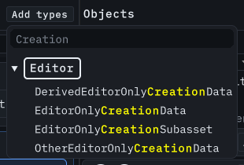
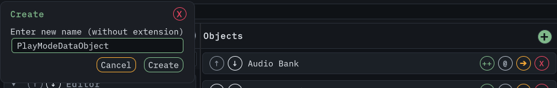

# Getting started

This page takes you from an empty project to an edited asset. It covers the first session only. The [README](https://github.com/Ambiguous-Interactive/DxVisualizer#readme) documents
the full feature set, including themes, processors, and extension points.

## Requirements

- Unity 2021.3 or newer. `package.json` declares that floor, and the window is developed and tested on Unity 6. The declared minimum is not a completed compatibility matrix. Follow
  [version validation](troubleshooting.md#validate-your-unity-version) before adopting the package.
- No additional package dependencies.

## Install the package

1. Open **Window → Package Manager**.
2. Select **+**, then **Add package from git URL**.
3. Enter `https://github.com/Ambiguous-Interactive/DxVisualizer.git` and select **Add**.

Unity imports the package, and the menu item appears.

## Open the window

Select **Tools → Wallstop Studios → DxVisualizer**, then dock it next to the Inspector. The window has three panels:

- **Namespaces and types** (left) lists your ScriptableObject types by C# namespace. Expand a namespace, then select a type to load its instances.
- **Objects** (center) lists every instance of the selected type. One row is selected at a time.
- **Inspector** (right) shows the full inspector for the selected asset, including custom editors and Odin Inspector integration.

## Add your types

The **Add types** menu above the namespace panel offers three commands:

- **Search Types** queries the ScriptableObject types Unity knows about. Add single types or a whole namespace in one action.
- **Scan Asset Folder** crawls a folder and registers the types and existing assets it finds. Use it to adopt a project that already has data.
- **Scan Scripts Folder** registers types from source folders, which is the right choice before you create any assets.

Removing a type or namespace only stops DxVisualizer from tracking it. Your assets stay on disk.



_Type search popover over the namespace panel. Regenerated from the live window by the docs capture pipeline._

## Create your first asset

If you already have a ScriptableObject type, use it. For a new project, create the `Assets/GameData` folder and save this complete example as `Assets/GameData/QuestData.cs` and let
Unity compile:

```csharp
namespace MyGame.Data
{
    using UnityEngine;

    public sealed class QuestData : ScriptableObject
    {
        [SerializeField]
        private string objective = "Meet the guide";

        [SerializeField]
        private int reward = 100;

        public string Objective => objective;
        public int Reward => reward;
    }
}
```

1. Open **Add types → Search Types**, find `QuestData`, and add it. Select the type in the left panel.
2. Open **Settings** and choose a **Data Folder**, such as `Assets/Data`.
3. Select **+** in the Objects header. Enter `First Quest`, then confirm **Create**.
4. Select the new object. For this example it is saved under `Assets/Data/MyGame/Data/QuestData/`.

Clones stay beside their original, whatever the Data Folder is. Removing a type from the catalog leaves the asset on disk.

 _Create opens from the **+** in the Objects header. The preview uses representative test data;
your selected type supplies the new asset's fields._

<span id="create-an-asset"></span>

## Edit your first asset

1. Select `First Quest` in the Objects panel.
2. Change **Objective** to `Collect three herbs` and **Reward** to `150` in the inspector.
3. Save the project with **Ctrl/Cmd+S**, close and reopen DxVisualizer, then return to `First Quest` to verify the values. Inspector field edits support Unity's Undo.
4. Search for `First Quest` in **Search all assets** and select the result to return to it. Searching `Collect` also finds its string field once indexing finishes.

Each object row has an **Actions** menu: **Clone** writes a copy beside the original, **Rename** renames the asset on disk, **Move** retargets it to another folder, and **Delete**
asks for confirmation. With the object list focused, use **Ctrl/Cmd+D** to clone the selected asset, **F2** to rename it, or **Delete** to request deletion. Text fields keep their
normal editing keys. Tab to a menu button and press Enter or Space to open it; use the arrow keys to choose a command and Escape to dismiss it.

## Filter and search

Three finders narrow different things, and they do not affect each other. The [Search and filtering](search-and-filter.md) page covers each one in full.

- The **Search all assets** box in the window header row searches every tracked type, not only the type you selected. It matches asset names, type names, asset GUIDs, and string
  fields on the assets themselves, so you can find an asset by what is inside it.
- The **Filter types** field above the namespace list narrows the type rows by display name, without case sensitivity. Namespace headers stay visible.
- Choose **Match all labels** or **Match any label**, then click label pills to select them. Tab and Enter or Space work too. **Advanced** preserves compound AND/OR expressions;
  **Clear** removes every label constraint.

## Keep your arrangement

Ordering, collapse state, tracked types, and your selection persist between sessions, and you can reorder namespaces, types, and instances directly in the window. The
[Organizing your data](organizing.md) page covers ordering, persistence, themes, and the Play Mode pause.

Under **Settings**, choose where that state lives:

- Leaving **Persist State in Settings Asset** off (the default) stores it in your local user cache, so each developer keeps a private arrangement and version control stays free of
  layout churn.
- The project settings asset stores the state in the repository, which suits a team that wants one shared arrangement.

**Select Active Object** mirrors your DxVisualizer selection in Unity's Inspector, and **Data Folder** sets where new assets are created. New assets land in a per-type folder under
it; clones stay beside their original.

## While the editor is playing

Entering Play Mode pauses package-driven work. The window keeps the last loaded view and shows _Package editing is paused during Play Mode_. While it is paused:

- **Create**, the add-type controls, and the inspector are disabled, and the inspector shows read-only content.
- Asset operations are refused: clone, rename, move, delete, and label changes.
- Selecting another type does not load its instances, and the catalog does not change.

Everything resumes when you leave Play Mode.

## Next steps

- [Search and filtering](search-and-filter.md) — what global search matches, its 25-result limit, and the exact AND/OR label rules.
- [Managing assets](managing-assets.md) — where each asset operation lives, where created files go, how clones are named, and how processors are scoped.
- [Organizing your data](organizing.md) — ordering, themes and their tokens, persistence, and what pauses during Play Mode.
- [Extending the window](extending.md) — attributes, `BaseDataObject`, lifecycle hooks, processors, and custom inspector content.
- The [historical video walkthrough](https://youtu.be/3oUxUSKNyhw) predates the 18 October 2026 rename; use these guides for current controls.
