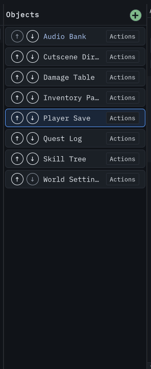
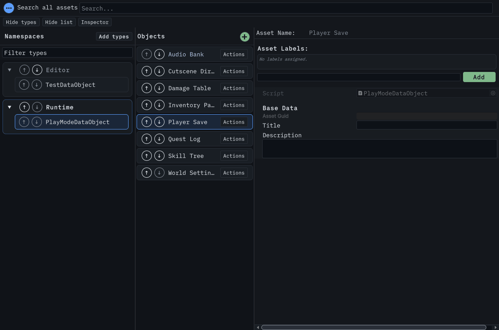
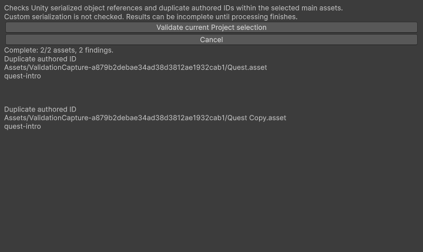

# Managing assets

This page covers the operations that change assets on disk, and the processors that change many at once. Everything here is refused while the window is paused for Play Mode; see
[While the editor is playing](organizing.md#while-the-editor-is-playing).

## Where an action lives

**Create** is the **+** button in the object list header; it always acts on the selected type.

**Clone**, **Rename**, **Move**, and **Delete** are in the **Actions** menu on each object row. They act on that row's object without selecting it first. Tab to **Actions** and
press Enter or Space to open the menu. Arrow keys choose a command; Escape closes the menu. With the object list focused, **Ctrl/Cmd+D**, **F2**, and **Delete** act on the selected
asset. On Mac keyboards, the Delete key sends Backspace and also opens confirmation. Delete still asks for confirmation. These shortcuts do not apply inside text fields.

 _Open **Actions** on a row for Clone, Rename, Move, or Delete.
Regenerated from the live window by the docs capture pipeline._

## Create

**Create** asks for a name, prefilled with the type's display name, and refuses a blank name or one containing a character that is invalid in a file name.

The asset is written to a per-type folder under your **Data Folder**, using the type's full name with each `.` replaced by a directory separator. For `MyGame.Items.WeaponData` with
a Data Folder of `Assets/Data`, the asset lands in `Assets/Data/MyGame/Items/WeaponData/`. Those folders are created for you.

If the name is already taken, nothing is written. When the existing asset is the same type it is selected and shown, and the dialog says so.

 _The animation alternates between the window and its Create
controls; it does not create an asset. [Static view](images/data-visualizer-create.png)._

## Clone

**Clone** copies the selected asset into the same folder as the original, and inserts the copy directly after the original in the list, then selects it.

Naming strips any existing `(Clone)` or `(Clone n)` from the source file name first, so repeated clones do not accumulate suffixes. The first clone is `(Clone)`, then `(Clone 1)`,
`(Clone 2)`, and so on. Unity's own unique-path check breaks any remaining collision.

Clones always stay beside their original. Your **Data Folder** does not affect them.

## Rename

**Rename** asks for a new name without the extension and validates it before touching the asset. The dialog reports `Invalid name.` for a blank name or an invalid character,
`Name is unchanged.` when nothing differs, and Unity's own `Invalid: …` message when the move would be rejected, for example onto an existing file.

The asset keeps its folder; only the file name changes.

## Move

**Move** opens a folder picker starting in the asset's current folder. The target must be inside the project's `Assets` directory; anything else is refused with an **Invalid
Folder** dialog. Moving an asset to the folder it is already in does nothing.

The asset keeps its file name.

## Delete

**Delete** asks for confirmation, naming the asset. Confirming removes the `.asset` file. Cancel does nothing.

## Processors

The **Processors** area sits below the Objects header. It lists every `IDataProcessor` implementation in your project whose `Accepts` list covers the selected type, sorted by name.
A processor with no `Accepts` list is never offered. The collapsed header shows how many processors are listed; the area is hidden entirely when none apply.

Clicking a processor opens a confirmation that names the processor and the number of objects it will receive. Confirming runs `Process`, saves assets, refreshes the AssetDatabase,
and schedules a window refresh. A processor that throws is caught: the exception is logged and an **Error running processor '…'** dialog reports the message. Other processors are
unaffected.

### ALL and FILTERED

The **ALL** / **FILTERED** switch above the processor list sets the scope.

- **ALL** passes every loaded instance of the selected type.
- **FILTERED** passes only the instances the [label filter](search-and-filter.md#label-filter) currently shows. With no label filter, that is the same set as **ALL**.

**FILTERED** is the default.

### Run a repeatable edit safely

1. Save or commit the assets you intend to process so you can restore them.
2. Add the complete [ItemData and TrimDescriptions examples](extending.md#processors), placing the processor in an **Editor** folder. Wait for compilation.
3. Add `ItemData` through **Add types**, create two instances, and enter descriptions with surrounding spaces.
4. Give one asset the `Reviewed` label in its inspector. Choose **Match all labels** and select `Reviewed` to narrow the list to that asset.
5. Wait for loading to finish, choose **FILTERED**, then select **Trim descriptions**. Check the named type and count in the confirmation before proceeding.
6. Reopen both assets. The filtered asset's description is trimmed; the other is unchanged. Choose **Clear** to restore the full view.

Use **ALL** only when every instance of the selected type is intended. Processor Undo depends on its implementation; this example does not register Undo. Recover unwanted changes
from your saved copy or version control.

### Refusal while loading

Instances stream in asynchronously. Running a processor while the selected type is still loading would touch only the subset that has arrived while the dialog implied the whole
type, so the run is refused with a **Loading In Progress** dialog. Wait for the load to finish, then run it.

Processors are also refused during the Play Mode pause, and the switch is disabled while the window is paused.

## Validate an explicit selection



Select ScriptableObject main assets in the Project window, then open **Tools → Wallstop Studios → Validate Selected Data Assets**. Select **Validate current Project selection**.
The report names each asset by path and GUID, and includes the serialized property path for a missing reference. **Cancel** stops between assets and retains a clearly partial
report. Play Mode and AssetDatabase activity pause processing. An unavailable asset produces a finding instead of silently disappearing from the scope.

`missing_reference` means a Unity serialized object reference has a nonzero identity whose target is missing. An intentionally null field is valid. `duplicate_authored_id`
identifies every asset sharing a nonempty `BaseDataObject.Id` within this selection, using ordinal, case-sensitive equality. It does not compare authored IDs with asset GUIDs,
check assets outside the selection, or rewrite IDs. Select all intended candidates when checking uniqueness.

The checks are read-only and never repair or save assets. They cover Unity serialized object references (including arrays, hidden fields, and cycle-safe managed-reference children)
and authored IDs. Custom/Odin serialization, exposed-reference resolver contexts, missing managed-reference types, and custom-inspector rules are outside coverage; zero findings
does not establish that those checks passed. Each asset is one cooperative work unit, so a large serialized asset can exceed the slice budget.

Editor tools can use the same service without opening the report window:

```csharp
using (var validation = new WallstopStudios.DataVisualizer.Editor.Utilities.EditorAssetValidation(assetGuids))
{
    validation.Advance(4);
    UnityEngine.Debug.Log($"Complete: {validation.IsComplete}; {validation.ProcessedCount}/{validation.TotalCount}");
    foreach (var finding in validation.Findings)
    {
        UnityEngine.Debug.Log($"{finding.Code}: {finding.Path} {finding.PropertyPath} {finding.Detail}");
    }
}
```

`assetGuids` is a nonempty list of 32-character asset GUIDs. The service copies and deduplicates it, never broadens scope, and reports `asset_unavailable` or `read_failed` per
asset. Keep the service alive and call `Advance` on successive editor updates to finish a larger scope; disposing an incomplete run cancels it. `LongestSliceMilliseconds` and
`SliceOverrunCount` report cooperative-budget overruns. Loading an asset can run its own Unity callbacks; the service does not invoke package mutation hooks.

## Undo

These operations are not on Unity's undo stack. Clone, rename, move, and delete change files directly. Inspector edits go through Unity's own serialized-object path and do support
undo.

## Next steps

- [Search and filtering](search-and-filter.md) — find objects and narrow them by label.
- [Organizing your data](organizing.md) — ordering, layout, persistence, and the Play Mode pause.
- [Extending the window](extending.md) — write your own processors.
