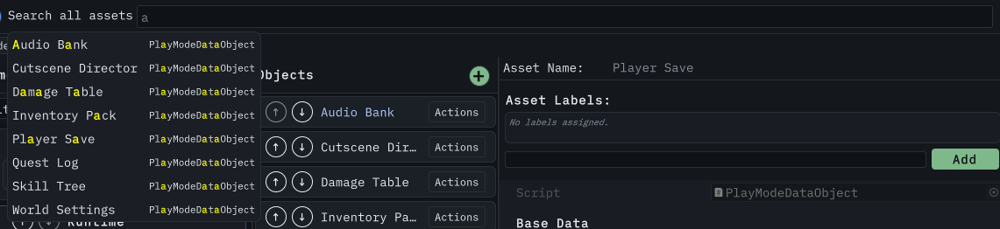
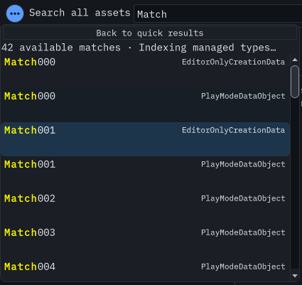

# Search and filtering

DxVisualizer has three separate finders. Each one narrows a different thing, and they do not affect each other.

| Finder        | Where it is                                 | What it narrows               |
| ------------- | ------------------------------------------- | ----------------------------- |
| Global search | Header row, next to the **Settings** button | Objects of every tracked type |
| Type filter   | Above the namespace list                    | Type rows in the left panel   |
| Label filter  | Below the object list header                | Objects of the selected type  |

## Global search

The search box sits in the window header row, above all three panels. It is not part of the Objects panel, and it does not search only the type you have selected.

Type a term and a popover opens with the matches. Each result shows the object's name and its type name. When the term matched something other than the name, type name, or GUID,
the result also shows up to two `field: value` lines naming the fields that matched, so you can tell why an asset is in the list.

 _Global search over every tracked type.
Regenerated from the live window by the docs capture pipeline._

### What it matches

Each space-separated term is matched on its own, and an object matches when any one of its terms matches somewhere. A term is checked against, in order:

1. the asset name,
2. the type name,
3. the asset GUID, as an exact match,
4. string fields on the asset and on nested plain objects.

Field matching is checked only when a term has not already matched the name, type name, or GUID, and it stops at the first field that matches, so a result names one matching field
per term rather than every match.

Field matching is case-insensitive. It skips primitives, `Vector2`, `Vector3`, `Vector4`, `Quaternion`, `Color`, `Rect`, and `Bounds`, and it does not follow references to other
Unity objects or assets. Cycles in nested plain objects are tracked, so a self-referencing structure terminates.

Matching terms are highlighted in the results. The highlight deepens while the pointer is over the row.

### Limits and behavior

- Quick search lists at most 25 results. Choose **Show all results** to browse every available match in a virtualized list. Results continue arriving during a long scan.
- **Back to quick results** preserves your query. Up and Down select rows in either view; Enter opens the selected asset. Escape closes the view and keeps your text.
- The full view reports matches found so far while scanning, available matches during indexing, and a total only after both finish.
- Opening an asset from full results keeps your query. Focus the search box to run it again.
- Results are ordered by asset name, then by full type name, both ordinal. Equal names and types use the asset GUID as a stable tie-breaker.
- Searching covers every tracked type, so a hit can be in a type you have not selected yet. Selecting a result switches to that object's type when needed and selects it there.
- Search shows matches from available records while the remaining assets are indexed. **Indexing managed types…** means the result set is incomplete; matching new records appear
  while the popover remains open. Dismissing it keeps it closed.
- Queries run in short steps. **Searching available records…** shows a scan in progress. With no matches, the message distinguishes an incomplete index from a complete search.
- Up and Down move the highlight and wrap around. Enter or Return opens the highlighted result. Escape closes the popover and keeps your text.

 _Full results over 42 real fixture assets. The
status distinguishes available matches from a complete total._

## Type filter

The **Filter types** field above the namespace list narrows the type rows by display name, without case sensitivity. Namespace headers are not filtered, so you keep the structure
while the types inside it narrow.

A display name comes from `[CustomDataVisualization]` when your type sets `TypeName`; otherwise it is the C# type name. Every space-separated term must match the display name.

## Label filter

Labels are Unity asset labels, the same ones you see on an asset in the Project panel.

1. Choose **Match all labels** to require every selected label, or **Match any label** to accept at least one.
2. Click a label pill to add it. A selected pill shows **×**; click it again to remove it.
3. Choose **Clear** to remove every constraint. Tab to pills or Clear and press Enter or Space to use the keyboard.

For example, selecting `Urgent` and `Reviewed` in **Match all labels** shows only assets with both labels. Switching to **Match any label** shows assets with either label. Labels
compare exactly: `Urgent` and `urgent` are different labels.

A readable expression stays above the controls, including active labels not currently used by any loaded asset. Those labels remain selected until you remove them; loading or
refreshing a type does not silently broaden its saved filter.

### Advanced expressions

Choose **Advanced** to combine two clauses. Existing compound filters open here automatically. Their saved combination, label casing, and result set stay unchanged. To replace a
compound expression with a simple filter, choose **Clear** first; choosing a simple mode alone never discards a clause.

**Available** lists labels on loaded instances. Use **+ AND** to require a label, or **+ OR** to add an alternative. Each selected label has a remove button. These buttons work
with Tab and Enter or Space; dragging pills between **Available**, **AND:** and **OR:** remains available.

### AND and OR

The **AND &&** / **OR ||** switch above the OR row picks how the two clauses combine.

Within **AND:**, an asset must have every listed label. Within **OR:**, it must have at least one listed label. The switch combines those two row results:

| Configured rows | AND mode                                  | OR mode                                   |
| --------------- | ----------------------------------------- | ----------------------------------------- |
| Neither         | All assets pass                           | All assets pass                           |
| AND only        | Every AND label is present                | Every AND label is present                |
| OR only         | At least one OR label is present          | At least one OR label is present          |
| Both            | Every AND label and at least one OR label | Every AND label, or at least one OR label |

For example, with **AND:** `Urgent`, `Reviewed` and **OR:** `Weapon`, `Armor`:

| Asset labels                   | AND mode | OR mode  |
| ------------------------------ | -------- | -------- |
| `Urgent`, `Reviewed`, `Weapon` | Match    | Match    |
| `Urgent`, `Reviewed`           | No match | Match    |
| `Armor`                        | No match | Match    |
| `Urgent`                       | No match | No match |
| None                           | No match | No match |

An empty row adds no constraint in AND mode and cannot independently satisfy OR mode. If only **AND:** `Urgent` is configured, an asset labeled `Urgent` passes in either mode. With
no labels configured, both modes show every asset.

Labels compare exactly, so `Urgent` and `urgent` are two different labels.

The **Labels** header refuses to collapse while any label is configured, so an active filter stays visible. In Advanced, both clauses remain visible together with their expression.

### What filtering changes

The filter narrows the list you see. It does not change what is on disk, and it does not change the order of the objects it keeps.

A neutral line reports the loaded rows shown and hidden by labels, including zero hidden. During loading these counts describe the loaded subset, not a complete project total.

The filter is stored per type and follows the persistence setting described in [Organizing your data](organizing.md).

## Label editing

The inspector panel for a selected asset has an **Asset Labels** section. Type a label and press **Add**, or press Enter, to attach it. The field suggests labels already used in
the project, and you can move through the suggestions with the arrow keys. Each attached label has a remove button.

Adding a label the asset already has is a no-op. Adding or removing a label saves the asset, refreshes the label cache, and re-applies the current filter, so you see the effect
immediately.

Label editing is package-driven asset editing, so it is refused during the Play Mode pause described in [Managing assets](managing-assets.md).

## Next steps

- [Managing assets](managing-assets.md) — create, rename, move, clone, delete, and run processors.
- [Organizing your data](organizing.md) — ordering, layout, and persistence.
- [Extending the window](extending.md) — attributes, `BaseDataObject`, processors, and custom inspector content.

### Refresh the published search image

Contributor instructions moved to the [image workflow](contributing-images.md#recreating-the-documentation-images).
